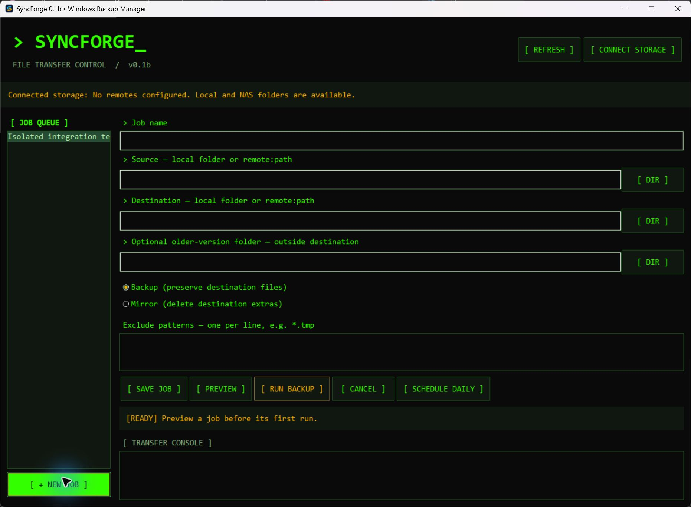

# SyncForge 0.1b

A Windows desktop GUI for rclone, built with Python's included Tkinter toolkit.

## Terminal update

The 0.1b Terminal Update adds a phosphor-green and amber interface, monospace
type, square panes, bracketed controls, and inverted hover states inspired by
the [Terminal CLI design preset](https://www.designprompts.dev/terminal).

Get the Windows ZIP or standalone EXE from
[GitHub Releases](https://github.com/Anon0ne/SyncForge/releases/tag/v0.1b-terminal).
The ZIP includes the launcher that automatically installs rclone. The standalone
EXE needs rclone installed already. Both include Python.

Tested the compiled application with temporary files: copying, exclusions,
updates, older-version preservation, destination-only file preservation in
backup mode, mirror deletion, job logs, and startup. Cloud transfers and Windows
Task Scheduler execution have not been verified in this release.

## Run

1. Install Python 3 with Tkinter and enable **Add Python to PATH**.
2. Double-click `Start SyncForge.cmd`. Startup checks for rclone, downloads it from the official site if missing, installs it under `%LOCALAPPDATA%\Programs\rclone`, and adds its folder to your user PATH. First setup requires internet access. Setup failures stop startup with a readable error; launch again to retry.

Existing rclone installations on PATH are reused. Restart other terminals to pick up a changed PATH. The app also finds the per-user installation directly, so existing sessions and scheduled jobs can use it immediately.

Use **Connect storage** to open rclone's interactive setup. Configure OneDrive,
Google Drive, Dropbox, S3 or SFTP there, then refresh connections. Credentials
remain in rclone's own configuration. Local paths and NAS UNC paths can be used
directly. Cloud paths use `connection:folder` syntax.

Create a named job, enter source and destination, preview it, then run it.
Backup uses `rclone copy`; mirror uses `rclone sync` and requires confirmation.
An optional older-version folder passes `--backup-dir` with a unique run folder.
Keep that folder outside the transfer destination. Restore files by creating a
copy job from the version folder to a chosen recovery folder. This is file-level
backup, not a Windows system image or snapshot of open databases.

**Schedule daily** registers a Windows Task Scheduler task for the signed-in
account. Keep Python and this project at their original paths. The computer must
be awake and storage available. Network drive letters may not be available to
scheduled tasks; use UNC paths. Schedules do not wake a sleeping PC or replay
missed runs. Avoid overlapping jobs that write to the same destination.

Jobs are stored in `%LOCALAPPDATA%\SyncForge\jobs.json`; scheduled output goes
to per-job `.log` files there. Manage or delete schedules in Windows Task Scheduler.

## Current scope

Working foundation: saved jobs, connected-storage listing, interactive rclone
configuration, exclusions, preview, live logs, cancellation, older-version
folders, and daily schedules. Remote folder browsing, a restore wizard,
retention cleanup, installer packaging, and overlap prevention are future work.

## Windows beta download

Download the ZIP from GitHub Releases, extract it, and run Start SyncForge.cmd. The executable includes Python. Keep the extracted folder in a permanent location if you create schedules.

## Build from source

Install Python 3, Pillow and PyInstaller, then run powershell -ExecutionPolicy Bypass -File build.ps1. Output is dist/SyncForge-0.1b-windows-x64.zip.

The icon was generated with OpenAI ImageGen. SyncForge is an independent GUI for rclone. Rclone is downloaded separately from its official distribution.
